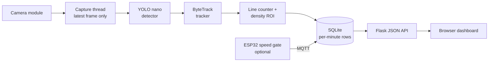

An object detector looks at one frame and says "I can see five vehicles". That sentence is useful, but it is not a traffic count. If the same five vehicles are visible for the next hundred frames, a naive program that adds the detections together will report five hundred. Counting is not a detection problem. It is a tracking problem, and almost every beginner traffic counter I have read about gets stuck exactly there.

This article is the design for a traffic monitor that handles that properly: a Raspberry Pi, a camera, OpenCV, a small YOLO model, a tracker, a counting line, a density estimate and a dashboard. It is the first of a harder set of builds, and it is deliberately a **school-scale simulation**. I would not point an unvalidated computer-vision system at a public road. Roads involve people who did not consent to being filmed, number plates, faces through windscreens, and conclusions that someone might act on. A toy-car track, a model road mat or footage you are explicitly permitted to record gives you the same engineering problems with none of those ethical ones.

:::note
**Status of this article:** this is a proposed design, not a report of finished measurements. I have not benchmarked this exact build, so I do not quote frame rates or accuracy figures. Where numbers matter, I describe how to measure them yourself.
:::

## The architecture before the parts list

The pipeline has five stages, and the most important design decision is that they do not run in lock-step.



Capture runs as fast as the camera delivers frames. Inference is slower. If the two share a loop, the camera's buffer fills with stale frames and your "live" view lags further behind reality every second. So the capture thread overwrites a single "latest frame" variable, and the inference loop always grabs the newest one and ignores what it missed. You lose frames, but you never lose time. For a counter, that is the correct trade-off, as long as vehicles do not move so far between processed frames that the tracker loses them. Choosing the processed frame rate is therefore a physical calculation, not a software preference: if a toy car crosses the whole field of view in two seconds, even four processed frames per second gives the tracker eight observations of it.

## Choosing hardware, honestly

| Part | Choice | Reason / caveat |
| --- | --- | --- |
| Computer | Raspberry Pi 5 (Pi 4 works, slower) | CPU inference only. A Pi has no GPU that PyTorch can use, so the model must be small. |
| Camera | Raspberry Pi Camera Module 3 or a UVC USB camera | The Pi 5 uses a smaller 22-pin camera connector, so a 15-pin camera needs an adapter cable. |
| Cooling | Active cooler | Sustained inference throttles an uncooled Pi. Check `vcgencmd get_throttled`. |
| Optional node | ESP32 + two IR break-beam sensors | Measures speed over a known distance. |
| Optional location | GPS module (NEO-6M class) | Metadata and time for a moving or portable unit. Not needed for a fixed rig. |
| Mounting | Overhead or high oblique | Vehicles occlude each other less from above. |

Camera mounting deserves more thought than the model does. A camera at road level sees cars as overlapping rectangles. A camera looking down from a high oblique angle separates them. For a tabletop track, a rigid arm holding the camera roughly 40 to 60 cm above the mat and tilted slightly is enough. Keep it fixed: the counting line is a pixel coordinate, and if the camera moves, your line no longer sits on the road.

## Capturing frames with Picamera2

On Raspberry Pi OS Bookworm the camera stack is libcamera, and the Python interface is Picamera2. Install `python3-picamera2` and `python3-opencv` with apt, and create your virtual environment with `--system-site-packages` so it can see them. Installing OpenCV from pip alongside the apt version is a classic way to end up with two conflicting builds.

```python
import threading, time
from picamera2 import Picamera2

class LatestFrame:
    """Capture thread that keeps only the newest frame."""
    def __init__(self, size=(1280, 720)):
        self.cam = Picamera2()
        cfg = self.cam.create_video_configuration(
            main={"size": size, "format": "RGB888"},  # delivers BGR byte order, as OpenCV expects
            controls={"FrameRate": 30},
        )
        self.cam.configure(cfg)
        # 50 Hz mains lighting: exposure in multiples of 10 ms avoids rolling banding
        self.cam.set_controls({"AeEnable": False,
                               "ExposureTime": 10000, "AnalogueGain": 4.0})
        self.cam.start()
        self.frame, self.lock, self.running = None, threading.Lock(), True
        threading.Thread(target=self._run, daemon=True).start()

    def _run(self):
        while self.running:
            f = self.cam.capture_array()
            with self.lock:
                self.frame = f

    def read(self):
        with self.lock:
            return None if self.frame is None else self.frame.copy()
```

The fixed exposure is not decoration. Under mains-powered lights, cheap LED and fluorescent fixtures flicker at twice the mains frequency, which is 100 Hz in India. An exposure that is not a multiple of the flicker period produces brightness bands that sweep through the image, and a model trained on clean images can behave oddly on them. A 10 ms exposure with higher gain trades noise for stability, and it also freezes motion better than the auto-exposure default in dim rooms.

## Detection: what a COCO model can and cannot do

Ultralytics ships small YOLO models pretrained on COCO, which already includes bicycle, car, motorcycle, bus and truck. For real footage that is a sensible starting point. For toy cars it is a trap. COCO's "car" class is learned from photographs of real vehicles, and a 7 cm die-cast model on a printed mat is a different visual domain: wrong textures, wrong proportions, often viewed from above. Expect missed detections and confident misclassifications.

The fix is not a bigger model. It is a small dataset of your own: a few hundred frames of your track with your cars in different positions and lighting, labelled with a tool such as Label Studio or Roboflow's free tier, and fine-tuned from the nano weights. This is the first honest lesson about edge AI: the model that works on the demo is the one trained on the demo.

On a Pi, export the model instead of running the PyTorch weights directly. Ultralytics supports exporting to NCNN, which is designed for ARM CPUs, and you load the exported folder the same way you load a `.pt` file. Input size is the biggest speed lever you have, because compute grows with the number of pixels. Dropping from 640 to 416 or 320 costs small-object accuracy, and toy cars from a high camera are small objects, so test it instead of guessing.

## From detections to a count

Ultralytics includes ByteTrack, which associates detections across frames and gives each object an ID. Once vehicles have persistent IDs, counting becomes a question of whether a given ID has changed sides of a virtual line.

```python
from ultralytics import YOLO

model = YOLO("toycars_ncnn_model")          # exported, fine-tuned weights
counter = LineCounter(y_line=360, hysteresis=8)

while True:
    frame = grabber.read()
    if frame is None:
        continue
    res = model.track(frame, persist=True, tracker="bytetrack.yaml",
                      imgsz=416, conf=0.35, verbose=False)[0]
    if res.boxes.id is None:
        continue
    boxes = res.boxes.xyxy.cpu().numpy()
    ids   = res.boxes.id.int().cpu().tolist()
    for (x1, y1, x2, y2), tid in zip(boxes, ids):
        cy = (y1 + y2) / 2
        direction = counter.update(tid, cy)
        if direction:
            db.log_crossing(direction)       # timestamped row
```

```python
class LineCounter:
    def __init__(self, y_line, hysteresis=8):
        self.y, self.h = y_line, hysteresis
        self.side, self.counted = {}, set()
        self.totals = {"down": 0, "up": 0}

    def update(self, tid, cy):
        if   cy < self.y - self.h: s = -1
        elif cy > self.y + self.h: s = +1
        else: return None                    # dead band: keep the previous side
        prev, self.side[tid] = self.side.get(tid), s
        if prev is None or prev == s or tid in self.counted:
            return None
        self.counted.add(tid)
        d = "down" if s == 1 else "up"
        self.totals[d] += 1
        return d
```

Two details matter. The dead band stops a vehicle whose centre jitters across the line from being counted several times. And remembering which IDs have already been counted protects against a tracker that briefly loses and re-finds an object. Neither makes the counter perfect, and in a long-running version you would also prune old IDs so the dictionaries do not grow forever.

## Density, speed and the optional ESP32 node

Counting tells you flow. **Density** tells you how congested the road is right now, and it needs a different measurement: count tracked vehicles inside a region of interest and divide by the real length of that region. On a model road mat, measure the region with a ruler and store pixels-per-centimetre in a config file. Dividing by length gives a vehicles-per-metre number that you can scale up to a real-world equivalent, as long as you label it as scaled.

For speed, a camera is a poor instrument unless it is calibrated against a known scene geometry. A simpler, more defensible approach is an ESP32 with two infrared break-beam sensors a known distance apart. The time between the beams gives the speed directly. Here is a compact sketch for the ESP32 Arduino core 3.x, using two interrupts and MQTT. Pin numbers are for a typical ESP32 DevKit, and GPIO34 and GPIO35 are input-only pins with no internal pull-ups, so the sensors need their own pull-up resistors.

```cpp
#include <WiFi.h>
#include <PubSubClient.h>

constexpr int PIN_A = 34, PIN_B = 35;          // input-only pins, external pull-ups
constexpr float GATE_M = 0.30f;                // measured gate spacing in metres

volatile uint32_t tA = 0, tB = 0;
void IRAM_ATTR isrA() { if (!tA) tA = micros(); }
void IRAM_ATTR isrB() { if (tA && !tB) tB = micros(); }

WiFiClient net;
PubSubClient mqtt(net);

void setup() {
  pinMode(PIN_A, INPUT); pinMode(PIN_B, INPUT);
  attachInterrupt(digitalPinToInterrupt(PIN_A), isrA, FALLING);
  attachInterrupt(digitalPinToInterrupt(PIN_B), isrB, FALLING);
  WiFi.begin("SSID", "PASSWORD");
  while (WiFi.status() != WL_CONNECTED) delay(200);
  mqtt.setServer("raspberrypi.local", 1883);
}

void loop() {
  if (!mqtt.connected()) mqtt.connect("speed-gate-1");
  mqtt.loop();
  if (tA && tB) {
    float v = GATE_M / ((tB - tA) / 1e6f);     // m/s on the model road
    char msg[48]; snprintf(msg, sizeof msg, "{\"v_ms\":%.2f}", v);
    mqtt.publish("school/traffic/gate1/speed", msg);
    tA = tB = 0;
  }
  if (tA && micros() - tA > 2000000UL) tA = 0; // a car that never reached B
}
```

This is a small sketch and it would sit comfortably inside any ESP32 flash layout, but I have not compiled it in this environment, so confirm the size on your own board. GPS is a separate question. A fixed rig should just store its coordinates in a config file. A GPS module only earns its place on a portable unit, where it also provides a time reference.

## Edge versus cloud, and what I would choose

| Factor | Edge (on the Pi) | Cloud inference |
| --- | --- | --- |
| Privacy | Frames never leave the device; only counts are stored | Raw video crosses the network |
| Latency | Bounded by the Pi's CPU | Adds network round-trip and queueing |
| Bandwidth | Tens of bytes per event | Continuous video upload |
| Model size | Constrained to nano-class models | Large models possible |
| Failure mode | Works offline | Stops when the connection drops |

For this project the choice is easy: edge. The output that matters is a number per minute, not a video, so there is no reason to move pixels off the device. If you keep any frames, keep them only for debugging and delete them on a schedule. A cloud model would be better at detecting small, awkward objects, and that is the honest cost of the edge decision.

## The dashboard

The simplest reliable backend is SQLite with one table of crossing events and a per-minute aggregate view, served by a small Flask app as JSON and drawn with Chart.js in a plain HTML page. Enable WAL mode so the dashboard can read while the counter writes. The three charts that tell a story are vehicles per minute by class, a rolling density value, and, if you built the speed gate, a speed histogram. A fourth panel showing the counter's own health, meaning processed frames per second and CPU temperature, is more useful than it sounds, because it tells you immediately when a slow dashboard is actually a throttling Pi.


## Troubleshooting

### The camera is not detected

The symptom is `no cameras available` from `rpicam-hello --list-cameras`, or Picamera2 raising an exception at startup. The usual cause is mechanical: a ribbon cable inserted the wrong way round or not fully seated, or a Pi 5 with a cable meant for older Pis. Power the Pi off, reseat both ends with the contacts facing the correct side, and confirm the cable type. Test with `rpicam-hello` before writing any Python, because it separates camera problems from code problems. A less obvious cause is a virtual environment created without `--system-site-packages`, where Python cannot import the apt-installed Picamera2 at all.

### The frame rate collapses after a few minutes

The symptom is a healthy first minute followed by a steady slowdown. The cause is thermal throttling or a growing backlog. Run `vcgencmd get_throttled` and `vcgencmd measure_temp` while the system runs; a non-zero throttle flag confirms it. Add an active cooler. If the temperature is fine, look at whether capture and inference are sharing a loop, which creates a queue of stale frames. The fix is the latest-frame pattern above, plus logging the actual processed frame rate once per second so the problem shows up as a number.

### The same car is counted twice

The symptom is totals consistently above a manual count. The cause is usually an ID switch: the tracker briefly loses a car in an occlusion or a low-confidence frame and assigns a new ID, and the new ID is on the opposite side of the line from its first observation. Diagnose it by saving a short annotated clip and watching the IDs. Corrections include a wider dead band, a lower detection confidence so the track is not dropped, placing the counting line where vehicles do not overlap, and, if needed, tuning the tracker's buffer length in a copy of the tracker YAML.

### The model ignores the toy cars

The symptom is empty detections on a clearly visible vehicle. The cause is the domain gap described earlier, sometimes made worse by a camera viewing angle the pretrained model rarely saw. Check by lowering `conf` to 0.1: if boxes appear with wrong labels, it is a training-data problem, not a bug. Fix it by collecting and labelling your own frames and fine-tuning. Keep a validation set of frames the model never trained on, otherwise a model that memorised your test frames will look better than it is.

### The detection quality changes with the lights

The symptom is good results in the afternoon and poor results under evening room lighting. The cause is a mixture of lower light, automatic exposure raising the gain, flicker banding, and shadows being detected as part of the vehicle. Lock exposure and gain, use diffuse lighting, and include both lighting conditions in the training set. Infrared illumination with an IR-sensitive camera is an option for dark scenes, but it changes the image statistics, so it needs its own training data.

## Making it exhibition-ready

The real-world problem is that traffic data is expensive to collect and usually counted by hand. What makes the project technically impressive is not that it runs YOLO, which is one library call. It is that it solves counting correctly with tracking, makes honest latency trade-offs on a CPU-only device, and keeps the raw video on the device.

The demonstration is a model road with a handful of cars driven past the camera by hand or on a simple motorised loop, with the dashboard updating live. Judges will ask what happens when cars overlap, how you know the count is right, what the system does at night, and why you did not use the cloud. You should have answers backed by data, and the measurable results are straightforward to collect. Record several clips, count the vehicles manually, and report counting error as a percentage, per-class precision and recall from a held-out set, processed frames per second, and CPU temperature over a long run. State the lighting conditions with every number.

Extensions include a second camera angle, per-class speed estimates from the ESP32 gate, a comparison of YOLO model sizes on accuracy against frame rate, and a Hailo or Coral accelerator if you want to see how much hardware changes the story. If you want to see how other sensor nodes stream data into a dashboard, my earlier [GPS school bus tracking build](/blog/gps-school-bus-tracking/) uses a similar telemetry idea, and the [predictive maintenance article](/blog/stm32-predictive-maintenance/) in this series shows the other side of edge computing, where the "model" is a handful of engineering features instead of a neural network.