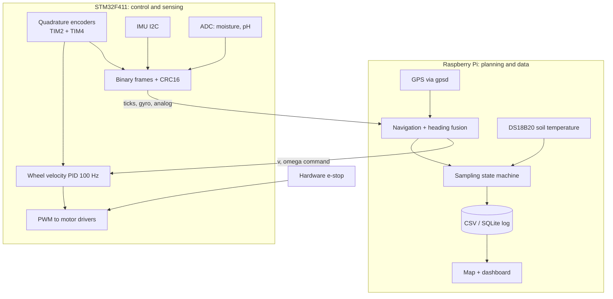
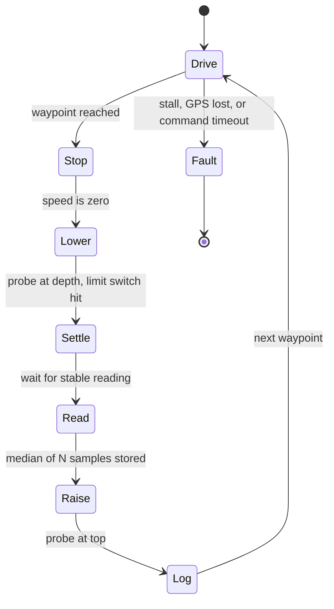

A soil moisture number on its own is almost useless. The same number means one thing at the top of a slope and another in the wet corner of a field, and a farmer cannot act on "34 %" without knowing where it came from. The valuable output of a soil-sensing robot is therefore not a reading. It is a reading attached to a position, taken in a consistent way, repeated across a field.

That sentence shapes the whole design of this rover. Driving a robot around is the easy part. The harder engineering questions are how it knows where it is, how it reaches a sampling point and stops there, how it takes a measurement that is comparable to the previous one, and how honest the resulting map is about its own uncertainty. This is a design for a rover that answers those questions on a school budget, along with a frank section on what it cannot do.

:::note
**Status of this article:** this is a proposed design, not a finished field-tested machine. Numbers such as encoder resolution and wheel size are example values to make the maths concrete, and I have not collected measurements from a real field with this rover.
:::

## Dividing the work between the Raspberry Pi and the STM32



The principle is that the thing that must never be late lives on the microcontroller, and the thing that benefits from software variety lives on the Pi. A Linux process can be delayed by a background update. A velocity control loop that runs from a timer interrupt cannot. So the STM32 runs the wheel controllers, reads the encoders in hardware and samples the analog soil sensors. The Pi reads the GPS, runs navigation, drives the sampling procedure and logs the data.

The link between them carries commands down and measurements up. For a control link I prefer a compact binary frame with a start marker, a length, the payload and a CRC16 over a text format, because it is smaller, fixed-rate and cheap to parse. If the STM32 stops receiving valid commands for about 300 ms, it ramps the motors to zero. That one rule protects against a crashed Python script, a unplugged cable and a Pi that has frozen, and it is the first safety feature I would implement, before any navigation code.

## Mechanical choices that decide whether the software can work

A two-wheel differential drive with a passive caster is the simplest platform to model, since its motion follows from two wheel speeds. A four-wheel skid-steer rover is more stable on rough ground, but turning it requires the tyres to scrub sideways across the soil, so the effective track width varies with the surface and odometry gets much worse. Tracks have the same problem. For a first version I would choose two driven wheels with a caster, accept a lower climbing ability, and put the effort into a well-balanced chassis with a low centre of gravity and the battery between the wheels.

Motors should be 12 V gear motors with Hall encoders, and the drivers must be rated for the motor's **stall** current, not its running current. A rover that gets stuck draws stall current, and an undersized driver fails exactly when you need it. Put a fuse in the battery line, a hardware emergency stop that cuts motor power independently of any software, and a 100 nF ceramic capacitor across each motor's terminals to reduce brush noise.

Power needs the same discipline as the mechanics. The Pi must run from its own buck converter rated comfortably above its load, and it must not share an unfiltered rail with the motors. When the motors start, a shared rail sags, the Pi's undervoltage detector trips, and the logger dies halfway through a field run. Keep a star ground, put bulk capacitance near the motor drivers, and keep high-current wires away from the encoder cables.

## Pin plan for the STM32

| Function | Peripheral | NUCLEO-F411RE pin |
| --- | --- | --- |
| Left encoder A/B | TIM2 encoder mode (32-bit) | PA0 / PA1 |
| Right encoder A/B | TIM4 encoder mode (16-bit) | PB6 / PB7 |
| Left / right motor PWM | TIM3 CH1 / CH2 | PA6 / PA7 |
| Left / right direction | GPIO | PB0 / PB1 |
| IMU SCL / SDA | I2C1 | PB8 / PB9 |
| Soil moisture (analog) | ADC1 IN10 | PC0 |
| pH interface board output | ADC1 IN11 | PC1 |
| Link to Pi | USART2 via ST-LINK VCP | PA2 / PA3 |
| Control loop tick | TIM5, 100 Hz update interrupt | — |

Two things in the table are board-specific. These pins come from the F411RE alternate-function tables and need checking in CubeMX. And the 100 Hz tick uses TIM5 because this chip family member has no basic timers: many tutorials use TIM6, which does not exist on the F411, so CubeMX simply does not offer it.

## Odometry: knowing how far you went

Each wheel encoder gives a count. Convert counts to distance with one number measured on the real robot: counts per metre of travel. With example values, say an 11-pulse-per-revolution encoder in 4× mode behind a 30:1 gearbox gives 1,320 counts per wheel turn, and a 13 cm wheel has a circumference of about 0.408 m, so one count is roughly 0.31 mm. A timer in encoder mode counts all this in hardware, with no CPU involvement, and the difference since the previous tick is computed with a signed cast so the counter wrap-around is harmless:

```c
static int32_t last_l, last_r;
void odom_step(float *ds_l, float *ds_r) {
  int32_t l = (int32_t)__HAL_TIM_GET_COUNTER(&htim2);       // 32-bit timer
  int16_t r = (int16_t)__HAL_TIM_GET_COUNTER(&htim4);       // 16-bit timer: cast handles wrap
  static int16_t last_r16;
  *ds_l = (l - last_l) * METRES_PER_COUNT;
  *ds_r = (int16_t)(r - last_r16) * METRES_PER_COUNT;
  last_l = l; last_r16 = r;
}
```

For a differential drive with track width *b*, the incremental motion is the average of the wheel distances for translation and their difference over *b* for rotation. On the Pi, the pose updates as follows, using the midpoint heading, which is more accurate than the starting heading:

```python
import math
def update_pose(x, y, th, ds_l, ds_r, b):
    ds  = (ds_r + ds_l) / 2.0
    dth = (ds_r - ds_l) / b
    x  += ds * math.cos(th + dth / 2.0)
    y  += ds * math.sin(th + dth / 2.0)
    return x, y, (th + dth + math.pi) % (2 * math.pi) - math.pi
```

Odometry is excellent for the last few seconds and dreadful over minutes. Errors accumulate: a slightly wrong wheel diameter makes the robot believe it travelled further or turned more than it did, and wheel slip on loose soil adds errors nothing in the encoders can see. A heading error of one degree becomes a sideways error of 1.7 cm for every metre travelled. So odometry cannot be the final answer for position, which is where fusion comes in.

The velocity controller on the STM32 deserves a note of its own. At 100 Hz, a 0.3 m/s robot moves 3 mm per control tick, which in my example is about ten encoder counts. A one-count error is then a ten percent velocity error, and a PID loop driven by such a quantised signal will chatter. Filter the measured velocity with a short moving average or a low-pass filter, or compute speed over a longer window, before feeding the controller.

## Fusion: gyro for the short term, GPS for the long term

A consumer GNSS receiver such as a u-blox NEO-M8N typically delivers positions accurate to a few metres in open sky, which is far too coarse to steer on, but it does not drift. A gyroscope gives smooth, low-noise rotation rates but integrates its own bias into an ever-growing heading error. Each sensor is strong exactly where the other is weak.

The heading estimate I would use is a complementary filter. Integrate the gyro's yaw rate for the fast response, and when the rover is moving fast enough for GPS course-over-ground to be meaningful, say above 0.5 m/s, nudge the estimate towards that course.

```python
def fuse_heading(th, gyro_z, dt, gps_course, speed, hdop, alpha=0.98):
    th += gyro_z * dt                              # smooth, but drifts
    if speed > 0.5 and hdop < 2.0 and gps_course is not None:
        err = (gps_course - th + math.pi) % (2 * math.pi) - math.pi
        th += (1 - alpha) * err * dt * 10          # slow pull toward GPS course
    return th
```

I would avoid relying on the IMU's magnetometer for heading. A rover full of motors, steel fasteners and battery current makes a deeply distorted magnetic environment, and a magnetometer reading there is a confident mistake. Calibrate the gyro bias by keeping the rover stationary for a few seconds at startup and averaging.

For position, convert GPS latitude and longitude into local metres relative to the first fix. Over a field-sized area, an equirectangular approximation is more than adequate: *x* is the longitude difference times the Earth radius times the cosine of the origin latitude, and *y* is the latitude difference times the Earth radius. Use GPS to anchor the position and odometry to interpolate between fixes. If you want centimetre-level accuracy, the honest upgrade is RTK GNSS with a base station or correction service, not a better filter.

## Navigating to a sampling point

For waypoint following, a proportional heading controller is enough for a slow rover. Compute the bearing to the next waypoint, compare it with the fused heading, and turn the angle error into a differential speed command, slowing down when the error is large so the rover turns before it drives.

```python
def steer(x, y, th, wx, wy, v_max=0.35, k_w=1.8):
    dx, dy = wx - x, wy - y
    dist = math.hypot(dx, dy)
    err = (math.atan2(dy, dx) - th + math.pi) % (2 * math.pi) - math.pi
    v = v_max * max(0.0, math.cos(err)) * min(1.0, dist / 1.0)
    w = k_w * err
    return v, w, dist
```

The Pi sends `(v, w)` and the STM32 converts it to left and right wheel speed targets with `v ∓ w·b/2`. A waypoint counts as reached when the rover is inside a tolerance radius that is deliberately bigger than the GPS error you expect. Pretending to be accurate to 10 cm with a 3 m GPS just makes the robot circle forever.

## The sampling routine

Measuring while moving would contaminate the data and wear the probe, so the rover samples with a stop-and-measure state machine.



A linear actuator with limit switches at both ends pushes the probe to a repeatable depth. Repeatability matters more than the absolute depth: moisture at 5 cm differs from moisture at 15 cm, and a map built from inconsistent depths is a map of depth. Each record in the log holds the timestamp, latitude, longitude, fix quality, HDOP, odometry pose, moisture raw value and converted value, pH raw value, soil temperature and probe depth. Keep raw values as well as converted ones. Recalibrating later is only possible if the raw numbers are still there.

## The honest limits of the soil measurements

This is the section that separates an engineering project from a toy.

A **capacitive moisture sensor** measures a dielectric property, not water directly, and its output depends on soil type, salinity, temperature, density and how well the blade contacts the soil. Air gaps along the blade make readings fall. The raw value therefore has to be calibrated for each soil: collect soil samples, measure their true water content by weighing them wet, drying them and weighing again, then fit a curve against the sensor's raw values. A hobby sensor without that calibration gives relative wetness at best.

**Soil pH** is the weakest measurement here. A typical glass pH electrode is fragile, needs to be kept wet and calibrated against buffer solutions, and gives meaningful readings only in water-saturated contact, which a dry field does not provide. The proper laboratory method mixes soil with water in a fixed ratio and measures the slurry. A probe pushed into dry soil is, bluntly, mostly measuring contact quality. Rugged in-soil pH probes exist, but I would still treat their readings as indicative. A defensible alternative for the project is a small sample-collection mechanism, so the rover brings soil back for slurry testing.

**Soil temperature** with a waterproof DS18B20 is the most reliable of the three, and it is read on the Pi through the one-wire interface.

More general limitations apply too. One point measurement says nothing about the metres between points. Compaction from the rover's own wheels changes the soil. Moisture varies quickly after rain and irrigation, so measurements taken hours apart are not comparable. Mapping by interpolating between points, for example inverse-distance weighting, produces smooth pictures that look more certain than the data supports, so show the sample locations on the map and avoid contouring areas far from any sample.

Improvements, in rough priority order: calibrate each sensor against laboratory measurements, add RTK GNSS, add a wheel-slip estimate by comparing odometry with GPS, add a probe-cleaning step between samples, take repeated measurements at each point and report the spread, and add a camera for canopy and ground-cover context.


## Troubleshooting

### The rover drifts to one side on a straight command

The symptom is a steady curve when both wheels are commanded to the same speed. The cause is a mismatch in the two wheel diameters, motor characteristics or encoder scaling, which the velocity controllers may hide while odometry still reports straight motion. Diagnose by driving a measured 5 m straight line, then comparing the commanded, odometry and tape-measure results, and by spinning the rover through ten full turns. Adjust the left/right scale factors and the effective track width until both tests agree. This is the idea behind the standard UMBmark calibration for differential-drive robots.

### The heading jumps or slowly rotates when stationary

The symptom is a heading that creeps while the rover sits still. The cause is gyro bias, which varies with temperature and over time. Check by logging the raw gyro rate while the rover is stationary and seeing a non-zero average. Subtract a bias measured at start-up, re-estimate it whenever the wheels have been stopped for a few seconds, and freeze the GPS correction when speed is too low for the course to mean anything.

### The GPS position jumps by metres near buildings or trees

The symptom is a track that teleports. The cause is multipath reflections and poor satellite geometry, which show up as a high HDOP or a low satellite count. Log the fix quality, HDOP and satellites used with every position, and reject fixes beyond a limit, so the filter falls back to odometry for a while. Mount the antenna on a small ground plane, high on the mast and away from the Pi and its USB cables, which radiate noise in the GNSS band.

### Encoder counts are wrong while the motors are running

The symptom is odometry that gains distance when the wheels are stalled or when a motor starts. The cause is brush noise coupling into the encoder lines and producing false edges. Diagnose with a scope on the encoder outputs while the motor is driven. For this kind of microsecond-scale glitch, the STM32 timer's input digital filter is the right tool, and it is a good contrast with a mechanical reed switch, where bounce lasts milliseconds and the filter does not help. Add the motor capacitors, twist and shield the encoder cable, and keep it away from motor wires.

### The Pi reboots whenever the motors start

The symptom is lost logs and a restarted Pi on acceleration. The cause is a voltage dip on a shared supply, often from a buck converter that cannot follow the load step. Check the 5 V rail with a scope triggered on the falling edge, and check `vcgencmd get_throttled` after a restart. Separate the Pi's supply, add bulk capacitance, ramp motor commands instead of stepping them, and tighten the connectors.

## Making it exhibition-ready

The real-world problem is that mapping soil conditions is slow and labour-intensive, and most smallholdings have no measurement data. The technical story is solid: differential drive kinematics, encoder-based odometry, gyro and GPS fusion, a separation of real-time control from planning, and a measurement procedure designed for repeatability.

The simplest demonstration is a marked area of lawn or a planted tray bed with a few waypoints, where the rover drives to each, takes a reading and plots it on a map. Judges are likely to ask how accurate the position is, why you used two computers, how you know the moisture readings mean anything, and what happens when GPS is poor. Measurable results include waypoint arrival error, straight-line drift over a fixed distance, odometry error over a loop, the repeatability of repeated readings at one spot, and the correlation between the sensor and weighed samples.

For extensions, consider RTK positioning, a camera and plant detection, and multi-day repeat surveys. The fusion ideas here continue in the [LiDAR SLAM robot article](/blog/raspberry-pi-lidar-slam-robot/), which uses a map instead of GPS, and the field-sensing side connects to my earlier [smart greenhouse build](/blog/automated-smart-greenhouse/) and the [environmental station design](/blog/multi-sensor-environmental-station/).