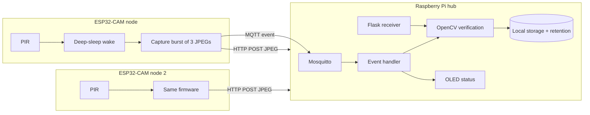

The first thing most people do with an ESP32-CAM is open the example web server and watch a live video stream. It is a satisfying moment and also a bad foundation for a surveillance system. A continuous MJPEG stream keeps the radio busy, keeps the chip hot, produces a mountain of footage nobody will review, and records people constantly whether anything is happening or not. If you scale that to four cameras, your Wi-Fi network and your privacy story both collapse.

The design in this article inverts that. Each camera node stays silent until a PIR sensor says something moved, sends a few JPEG frames and a small message, and goes back to sleep. A Raspberry Pi receives those events, double-checks them with OpenCV, stores what is worth keeping, and discards the rest. The engineering theme is *do less, deliberately*, and it happens to be the more private design too.

:::warning
**Use this only in an authorised, private demonstration space** such as a classroom or lab where everyone present knows about it and has agreed, with a visible notice. Never point it at neighbours, public areas, changing rooms, toilets or anyone who has not consented. Rules about recording people differ by country, and in India the Digital Personal Data Protection Act, 2023 may apply to images of identifiable people, so ask your school before you collect anything.
:::

:::note
**Status of this article:** this is a proposed design. I have not built or measured this exact system, so the bandwidth figures are calculations from stated assumptions, not test results.
:::

## The architecture



I split the traffic into two channels on purpose. MQTT is excellent for small, reliable messages: "node 2 saw motion at 14:03:12". It is a poor way to move 30 KB images, because client libraries have message-size limits, and large publishes block the connection for other traffic. So the node publishes a tiny event over MQTT and posts the actual JPEG frames to a small HTTP endpoint on the Pi. The Pi correlates the two using a node ID and an event counter.

## The node: ESP32-CAM details that bite

The common AI-Thinker ESP32-CAM has an OV2640 sensor, 4 MB of external PSRAM and no USB port. You program it through an FTDI adapter, or a carrier board with a USB bridge, and you have to ground GPIO0 to enter flash mode and remove that ground afterwards. A very common "my board does nothing" cause is leaving GPIO0 grounded.

Pins matter here. The camera consumes most of the usable GPIOs, which leaves very few for a PIR. GPIO13 is a sensible choice: it is free on this board, it is not a boot-strapping pin, and it supports RTC wake-up from deep sleep. GPIO12 is the pin to avoid, because its level at boot selects the flash voltage and a PIR that happens to be high can stop the board from booting at all. GPIO4 drives the bright onboard flash LED and is shared with the microSD slot, so I leave the SD card unused and store images on the Pi.

The **HC-SR501 PIR** is a convenient module with a 3.3 V output signal, but it wants a 5 V supply and takes up to a minute to settle after power-up, so early readings are unreliable. A smaller 3.3 V PIR such as the AM312 is easier to power but less adjustable. Either way, treat a PIR as a trigger, not a witness: it detects changes in infrared radiation, so a warm air current or a heater cycling can fool it.

Power is the other trap. The camera and Wi-Fi together can draw current spikes that a weak USB port or thin jumper wire cannot supply, and the ESP32 reacts by browning out and rebooting. Use a decent 5 V supply, short thick wires, and a bulk capacitor close to the board's 5 V pin.

### The firmware (ESP32 Arduino core 3.x)

The camera configuration structure changed names between core versions. In core 3.x the camera bus pins are called `pin_sccb_sda` and `pin_sccb_scl`, and building older example code unchanged is a classic source of compile errors. This is the structure I would use for the AI-Thinker pinout.

```cpp
#include "esp_camera.h"
#include <WiFi.h>
#include <HTTPClient.h>
#include <PubSubClient.h>

static camera_config_t cam_cfg() {
  camera_config_t c = {};
  c.ledc_channel = LEDC_CHANNEL_0; c.ledc_timer = LEDC_TIMER_0;
  c.pin_d0 = 5;  c.pin_d1 = 18; c.pin_d2 = 19; c.pin_d3 = 21;
  c.pin_d4 = 36; c.pin_d5 = 39; c.pin_d6 = 34; c.pin_d7 = 35;
  c.pin_xclk = 0; c.pin_pclk = 22; c.pin_vsync = 25; c.pin_href = 23;
  c.pin_sccb_sda = 26; c.pin_sccb_scl = 27;
  c.pin_pwdn = 32; c.pin_reset = -1;
  c.xclk_freq_hz = 20000000;
  c.pixel_format = PIXFORMAT_JPEG;
  c.frame_size   = FRAMESIZE_VGA;       // 640x480: small, enough for motion verification
  c.jpeg_quality = 12;                  // lower number = higher quality, larger file
  c.fb_count     = 2;
  c.fb_location  = CAMERA_FB_IN_PSRAM;
  c.grab_mode    = CAMERA_GRAB_LATEST;
  return c;
}

void sendBurst() {
  for (int i = 0; i < 3; i++) {
    camera_fb_t *fb = esp_camera_fb_get();
    if (!fb) continue;
    if (i > 0) {                         // frame 0 is discarded: auto-exposure is still settling
      HTTPClient http;
      http.begin("http://raspberrypi.local:5000/upload");
      http.addHeader("Content-Type", "image/jpeg");
      http.addHeader("X-Node-Id", "cam1");
      http.addHeader("X-Token", NODE_TOKEN);
      http.POST(fb->buf, fb->len);
      http.end();
    }
    esp_camera_fb_return(fb);            // always return the buffer or the driver starves
    delay(300);
  }
}

void setup() {
  esp_sleep_wakeup_cause_t why = esp_sleep_get_wakeup_cause();
  camera_config_t c = cam_cfg();
  if (esp_camera_init(&c) != ESP_OK) { esp_deep_sleep_start(); }
  WiFi.begin(WIFI_SSID, WIFI_PASS);
  uint32_t t0 = millis();
  while (WiFi.status() != WL_CONNECTED && millis() - t0 < 8000) delay(100);
  if (WiFi.status() == WL_CONNECTED && why == ESP_SLEEP_WAKEUP_EXT0) {
    sendBurst();
    // then publish a small MQTT event (see the reliability section)
  }
  esp_sleep_enable_ext0_wakeup(GPIO_NUM_13, 1);   // wake when PIR output goes high
  esp_deep_sleep_start();
}
void loop() {}
```

A few things in this sketch are deliberate. The first frame is thrown away because the OV2640's automatic exposure and white balance need several frames to settle, and the first image is often dark or tinted. `esp_camera_fb_return` is called for every buffer, because forgetting it leaves the driver with no free buffers and every later capture fails. Wi-Fi gets a timeout rather than an infinite wait, so a missing access point cannot drain the battery in an endless connect loop.

The trade-off of deep sleep is latency. The board has to boot, initialise the camera and associate with Wi-Fi after every trigger, which takes on the order of seconds, so you miss the first moments of the event. If the first second matters, the alternative is an always-awake node with light sleep, at the cost of more power. I cannot quote the board's sleep current either: the whole board, with its regulator and camera module, typically draws far more than the bare chip's datasheet figure, so measure it with a meter if battery life is a goal. As for flash fit, I have not compiled this here, so check the size line your IDE reports. The camera driver, Wi-Fi, HTTP and MQTT libraries together are a substantial but ordinary ESP32 build; if it is close to the limit on your partition table, choose a layout with a larger app partition, and make sure PSRAM is enabled in the board options or frame-buffer allocation will fail.

## The hub: verifying events with OpenCV

A PIR trigger with no visible change in the image is a false positive, and the hub can find these cheaply. The three-frame burst gives a time difference to work with: blur the first and last frames, subtract them, threshold, and measure how much of the image changed.

```python
import cv2, numpy as np

def motion_fraction(jpegs, thresh=25):
    g = [cv2.imdecode(np.frombuffer(j, np.uint8), cv2.IMREAD_GRAYSCALE) for j in jpegs]
    a, b = (cv2.GaussianBlur(f, (21, 21), 0) for f in (g[0], g[-1]))
    diff = cv2.absdiff(a, b)
    _, mask = cv2.threshold(diff, thresh, 255, cv2.THRESH_BINARY)
    mask = cv2.dilate(mask, None, iterations=2)
    return cv2.countNonZero(mask) / mask.size

if motion_fraction(burst) > 0.01:          # more than 1% of pixels changed
    save_event(node_id, burst)
else:
    log_discarded(node_id, "pir_false_positive")
```

The 1 percent threshold is a starting point you tune against your own room, not a universal constant. A human walking through a VGA frame changes far more pixels than a flickering light, but that is a statement about *your* scene, and you should confirm it with a few test clips. For a stronger filter, a small person-detection model through `cv2.dnn` can run on the burst, but I would add it only after the simple version works and is measured, because every added stage is another thing to debug.

Images are saved with a node ID and UTC timestamp in the filename, in a directory readable only by the service account. A nightly job deletes events older than a retention period you decide in advance, say seven days, and also deletes the oldest files if free disk space drops below a threshold. Retention is a privacy control as much as a housekeeping one: footage that no longer exists cannot leak.

## Network reliability and MQTT done properly

MQTT gives you three features that make a multi-node system manageable. A **Last Will and Testament** is a message the broker publishes on behalf of a client that vanishes. Each node connects with a will on `school/cam/<id>/status` saying `offline` and a retained `online` message after connecting, so the hub always knows which nodes are alive. **QoS 1** makes an event delivered at least once, and the hub deduplicates by event counter. **Retained messages** give a freshly started dashboard the latest known state at once.

On the Pi, run Mosquitto with `allow_anonymous false`, a password file, and a TLS listener on port 8883 with your own certificate authority. On the Python side, paho-mqtt 2.x requires you to choose a callback API version when constructing the client, and older tutorials that omit it will fail:

```python
import paho.mqtt.client as mqtt
hub = mqtt.Client(mqtt.CallbackAPIVersion.VERSION2, client_id="hub")
hub.username_pw_set("hub", HUB_PASSWORD)
hub.tls_set(ca_certs="/etc/mosquitto/certs/ca.crt")
hub.on_message = on_event
hub.connect("localhost", 8883)
hub.subscribe("school/cam/+/event", qos=1)
hub.loop_start()
```

Two caveats about the node sketch above: it posts over plain HTTP so that the core camera logic stays readable. For anything beyond a bench test, put the receiver behind TLS and load your CA certificate into the node with `WiFiClientSecure::setCACert`, and remember that the `PubSubClient` library has a default 256-byte message buffer, so call `setBufferSize` if your event JSON ever grows.

## Bandwidth, with the assumptions shown

Suppose a VGA JPEG at quality 12 is roughly 25 to 40 KB depending on scene detail. That is an assumption, and your own camera and room will differ. A continuous stream at 10 frames per second would be about 250 to 400 KB per second per camera, which is 2 to 3 megabits per second of sustained traffic each. Four cameras is a heavy load for a shared 2.4 GHz Wi-Fi channel.

The event-driven version sends two frames per event after discarding the first. At ten events per hour, that is about twenty frames per hour, or under a megabyte per hour per node. Even with a hundred events an hour the traffic is trivial. The saving is more than two orders of magnitude, and the privacy benefit follows the same logic: there is simply far less recorded data.

## Privacy and secure access, as design requirements

I treat these as part of the architecture, not a footnote. Put the cameras and hub on a separate Wi-Fi network or VLAN with no route to the internet and no port forwarding. Change every default credential, use a unique token per node, and do not expose the hub's web interface beyond that network. Add a visible sign saying what is recorded, where and for how long. Keep no audio, run no face recognition, and store no more than the minimum needed. Give people a way to ask for their images to be removed. And log who has accessed the footage, because a surveillance system with no access record is just a risk.


## Troubleshooting

### `Camera probe failed with error 0x105`

The symptom is the node rebooting or sleeping immediately, with a serial message that the camera could not be found. The cause is almost always physical: a camera ribbon not fully seated in its latch, a pin map that does not match the board variant, or insufficient power at initialisation. Check the ribbon first, because it is the most frequent culprit. Then confirm you selected the correct board and used the pin set for that exact module, since clones differ. Finally, test on a stronger supply, because a marginal supply can also make the probe fail.

### Random resets and `Brownout detector was triggered`

The symptom is a reset when Wi-Fi turns on or the first frame is captured. The cause is a supply that sags under the current spike. Measure the 5 V pin with a scope or a logging multimeter while the node boots. The fix is a better power source, shorter and thicker wires, and a 470 µF or larger capacitor near the board. Disabling the brownout detector in software hides the symptom while leaving the cause, and I would not do it.

### `esp_camera_fb_get` returns NULL or images are corrupted

The symptom is missing frames or an `ESP_ERR_NO_MEM` message. The cause is memory. Either PSRAM is disabled in the board options, so the large frame buffers have nowhere to go, or the frame size and buffer count exceed what is available, or buffers are not being returned. Check PSRAM first, then drop to a smaller frame size or `fb_count = 1`, and audit the code for any path that skips `esp_camera_fb_return`. Corrupted images with horizontal tearing often point at a marginal supply or a loose camera connection, not at software.

### MQTT events vanish or the hub reports the node offline

The symptom is events that appear intermittently and nodes that flip between online and offline. Possible causes are Wi-Fi association failures after sleep, a keep-alive interval too short for a node that is mostly asleep, a payload larger than the library's buffer which fails silently, or a broker that rejects an unauthenticated client. Diagnose from the broker side by reading Mosquitto's log, which tells you whether connections arrive, drop, or are refused. A node that sleeps should disconnect cleanly, and the hub should treat the retained status message as truth, not guess from silence.

### The PIR triggers constantly, or never

The symptom is dozens of events with nothing in them, or no events at all. A warm-up period shortly after power-on, a sensitivity potentiometer turned too high, a heater or window in the field of view, and a retrigger jumper in the wrong setting are all candidates. Wait the full warm-up, aim the sensor away from heat sources, and log the raw pin state with timestamps. If the pin is stuck high at boot, check that you did not choose a strapping pin. The OpenCV verification step then becomes your safety net, and the discard log tells you how often the PIR is wrong, which is itself a nice number to present.

## Making it exhibition-ready

The real-world problem is monitoring a space cheaply without drowning in footage or compromising privacy. The impressive part is the distributed design: event-driven nodes, a split between small messages and large payloads, hub-side verification, retention policy and secure access, all on hardware that costs a few hundred rupees per node.

For the demonstration, set up two nodes in a consenting classroom, walk through the field of view, and show the dashboard receiving events while the hub's discard log rejects a heater-triggered false alarm. Judges are likely to ask how you protect privacy, what happens when Wi-Fi drops, how much bandwidth you save, and why you used a PIR when the camera can detect motion itself. Measurable results include event-detection rate, PIR false-positive rate before and after OpenCV verification, end-to-end latency from trigger to stored image, megabytes per hour compared with a streaming baseline, and node uptime.

Extensions include battery and solar power, a person-detection model on the hub, encrypted storage, and a retention dashboard. If you want the camera-and-model side of this idea in depth, the [AI traffic monitoring article](/blog/ai-smart-traffic-monitoring/) covers detection and tracking pipelines on the Pi, and my earlier [RFID smart locker](/blog/rfid-smart-locker/) shows a simpler take on access control that pairs well with a camera hub.