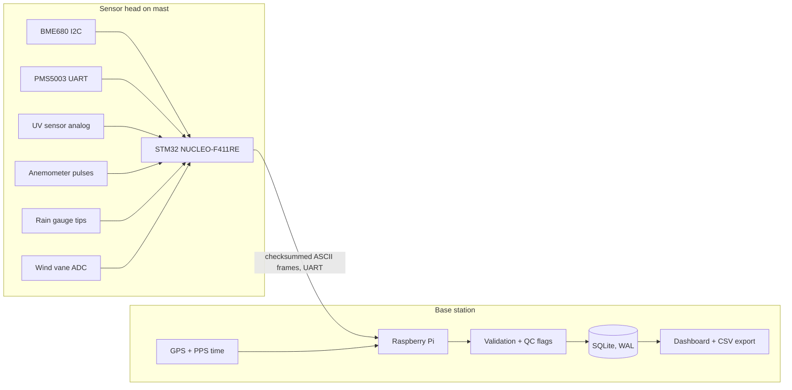

A weather station that shows a temperature on a screen is easy. A weather station whose numbers someone else could reasonably use is a different project entirely. The difference has almost nothing to do with the sensors and almost everything to do with what happens around them: calibration, timestamps, checksums, sanity checks, metadata and an honest record of when a sensor was broken.

This article is the design for an environmental station built around that idea. The sensors are ordinary hobby parts. The engineering effort goes into making their output trustworthy enough that a school project could, with patience and a calibration log, grow into a small research station. If you built the [portable air quality monitor](/blog/portable-air-quality-monitor/) from my first series, think of this as the next step: the same kind of sensors, but with a proper data pipeline behind them.

:::note
**Status of this article:** this is a proposed design. I have not run this station through a long deployment and I make no accuracy claims for it. Where I give conversion constants, they come from the sensor manufacturers' documentation for the specific parts named, and you should check them against your own hardware.
:::

## Two boxes, one cable: why the split exists

The architecture divides the station into a **sensor head** on a mast and a **base station** indoors.



The STM32 owns everything that needs predictable timing or fast reaction: counting wind pulses, catching rain-gauge tips, reading analog voltages, timing the particle sensor's laser duty cycle and talking to I²C and UART sensors. The Raspberry Pi owns everything that benefits from an operating system: a database, a web interface, time synchronisation, long-term storage and the quality-control logic. The cost of this split is two programs to maintain and one more failure point, the link between them. The gain is that a slow database write or a Linux update can never make the station miss a rain-gauge tip.

I would use a NUCLEO-F411RE and USB to the Pi, so the board's built-in ST-LINK exposes a virtual COM port, usually `/dev/ttyACM0`. Nothing is wired for the data link. For a mast more than a couple of metres from the Pi, TTL UART is the wrong answer, because noise and ground differences corrupt it. A pair of RS-485 transceivers is the sturdier choice for longer cable runs, and the framing described below works unchanged over either.

## Sensors and their interfaces

| Measurement | Part | Interface | Notes |
| --- | --- | --- | --- |
| Temperature, humidity, pressure, gas resistance | BME680 | I²C1, addresses 0x76/0x77 | 3.3 V part; gas channel is relative, not a calibrated air-quality index |
| Particulate matter | PMS5003 | USART1 9600 8N1 | 5 V supply, 3.3 V logic; SET pin sleeps the laser |
| UV | Analog UV photodiode module (GUVA-S12SD type) | ADC1 | Approximates UV index; broad spectral response |
| Wind speed | Cup anemometer with reed switch | EXTI | Pulses per second to speed |
| Rainfall | Tipping-bucket gauge | EXTI | Fixed volume per tip |
| Wind direction | Resistor-ladder vane | ADC1 | Lookup table of voltages |
| Time and place | GPS module | UART on Pi | Time, position and PPS |

| Signal | NUCLEO-F411RE pin |
| --- | --- |
| BME680 SCL / SDA | PB8 / PB9 (I2C1) |
| PMS5003 TX → STM32 RX, STM32 TX → PMS RX | PA10 / PA9 (USART1) |
| PMS5003 SET | PB0 |
| UV analog out | PA1 (ADC1 IN1) |
| Wind vane analog | PA4 (ADC1 IN4) |
| Anemometer | PC0 (EXTI0) |
| Rain gauge | PC1 (EXTI1) |
| Link to Pi | PA2 / PA3 (USART2 via ST-LINK VCP) |

These pins are the ones I selected from the F411RE's documentation. Check them in CubeMX and against your board's user manual before wiring, because STM32 boards do not share a pin map.

A few of these parts hide traps. The BME680's gas resistance is a raw number that depends on its heater profile and its history, and Bosch's own index output comes from a proprietary library called BSEC that needs a burn-in period. A raw gas resistance trend is useful for "the air changed", and it is wrong to label it as a pollutant concentration. The BME680's heater also warms the chip itself, which biases the temperature and humidity readings upward unless you account for it, and placing the sensor next to anything warm makes it worse. The PMS5003 draws roughly 100 mA with the fan and laser running, wants 5 V, and its manufacturer recommends waiting about half a minute after wake before trusting a reading. Duty-cycling it, for example 30 s on and four minutes asleep, extends its life. The UV module outputs a very small voltage, a few hundred millivolts in strong sun, so the ADC reading is coarse unless you amplify it or average heavily.

## Counting pulses without trusting a reed switch

A reed switch is a mechanical contact, and mechanical contacts bounce. A single anemometer revolution can generate a burst of edges lasting a millisecond or more. The STM32's timer input filter is not a fix for this: its digital filter works on a timescale of microseconds, far shorter than contact bounce. There are two honest options. One is an RC filter and Schmitt trigger in hardware. The other is a software dead time in the interrupt handler, which is what I would do.

```c
volatile uint32_t wind_pulses = 0, rain_tips = 0;
static uint32_t last_wind_ms = 0, last_rain_ms = 0;

void HAL_GPIO_EXTI_Callback(uint16_t pin) {
  uint32_t now = HAL_GetTick();
  if (pin == GPIO_PIN_0 && now - last_wind_ms >= 5)  { wind_pulses++; last_wind_ms = now; }
  if (pin == GPIO_PIN_1 && now - last_rain_ms >= 100) { rain_tips++;  last_rain_ms = now; }
}
```

The dead times come from the physics. For a common weather-meter kit, one anemometer pulse per second corresponds to 2.4 km/h, so even a very strong wind of 120 km/h is only 50 pulses per second, a 20 ms period. A 5 ms dead time rejects bounce without clipping real pulses. A tipping bucket in heavy rain tips a few times per minute, so 100 ms is generous. The same kit specifies 0.2794 mm of rain per tip. Those constants belong to that specific kit, so confirm yours from its datasheet and then verify them by experiment, which I come back to in the calibration section.

Wind speed is pulses divided by the window length, times the constant. A three-second window gives a gust value, the meteorological convention, and a ten-minute average gives the mean speed. For wind direction, never take an arithmetic average of angles, because the mean of 350° and 10° is 0°, not 180°. Use a vector mean on the Pi:

```python
import math
def mean_direction(deg_list, speeds=None):
    w = speeds or [1.0] * len(deg_list)
    s = sum(math.sin(math.radians(d)) * k for d, k in zip(deg_list, w))
    c = sum(math.cos(math.radians(d)) * k for d, k in zip(deg_list, w))
    return (math.degrees(math.atan2(s, c)) + 360) % 360
```

## Receiving the particle sensor reliably

The PMS5003 sends a 32-byte frame: the bytes `0x42 0x4D`, a length field, thirteen 16-bit data words and a 16-bit checksum that is the sum of the first thirty bytes. The data begins with three "CF=1" mass concentrations, which are for factory calibration, followed by three "atmospheric" concentrations, which are the ones you want, then particle counts per size bin.

A UART byte stream has no framing, so the receiver must find the header itself, and a parse that assumes the buffer starts on a frame boundary will occasionally read a shifted frame and publish nonsense. On the STM32, `HAL_UARTEx_ReceiveToIdle_DMA` hands you chunks when the line goes idle, and a validation function protects against misalignment:

```c
typedef struct { uint16_t pm1, pm25, pm10; } pms_t;

bool pms_parse(const uint8_t *f, pms_t *out) {
  if (f[0] != 0x42 || f[1] != 0x4D) return false;
  uint16_t sum = 0;
  for (int i = 0; i < 30; i++) sum += f[i];
  if (sum != (uint16_t)((f[30] << 8) | f[31])) return false;
  out->pm1  = (f[10] << 8) | f[11];     // atmospheric environment, ug/m3
  out->pm25 = (f[12] << 8) | f[13];
  out->pm10 = (f[14] << 8) | f[15];
  return true;
}
```

If the check fails, search the buffer for the next `0x42 0x4D` and retry. A failure is a missing reading, never a zero.

## The data link: a protocol you can debug with your eyes

Between the boards I would use plain ASCII lines with an NMEA-style XOR checksum. It is not the most efficient format, but a human can read it in a serial terminal, which is worth more than saving a few bytes at one frame per ten seconds.

```
$ENV,1842,251033,29.4,61.2,1004.8,87420,12,18,21,310,3.4,7.1,0.28,215,0x03*5A
```

The fields are a sequence number, STM32 uptime in milliseconds, temperature, humidity, pressure, gas resistance, PM1.0, PM2.5, PM10, UV in millivolts, mean wind speed, gust, rain in the interval, vane direction and a status bitmask. The sequence number lets the Pi detect lost frames, the uptime lets it detect an STM32 reset, and the bitmask carries sensor health, one bit per sensor, so a failed sensor is reported as failed rather than silently dropped.

The Pi side verifies the checksum, then applies validation before anything is stored as a trusted value.

```python
import sqlite3, time

def validate(rec, prev):
    flags = 0
    if not (-10 <= rec["t"] <= 55):            flags |= 0x01   # range
    if not (0 <= rec["rh"] <= 100):            flags |= 0x02
    if prev and abs(rec["t"] - prev["t"]) > 3: flags |= 0x04   # rate of change per interval
    if rec["status"] & 0x01:                   flags |= 0x08   # sensor reported failure
    return flags

db = sqlite3.connect("station.db")
db.execute("PRAGMA journal_mode=WAL")
db.execute("""CREATE TABLE IF NOT EXISTS obs(
  ts_utc TEXT, seq INTEGER, uptime_ms INTEGER, t REAL, rh REAL, p REAL, gas REAL,
  pm25 REAL, uv_mv REAL, wind REAL, gust REAL, rain REAL, wdir REAL, qc INTEGER)""")
```

Raw values are stored with a QC flag instead of being discarded or "fixed". A wrong reading you deleted is gone; a flagged one still tells the story of the failure. Storing in UTC avoids every daylight-saving and timezone argument later.

## Time, which is harder than it looks

The STM32 does not know the date. The Pi stamps each frame on arrival, and that adds a small, roughly constant delay. For ten-second weather data that is fine, but it assumes the Pi's clock is right. A Raspberry Pi has no battery-backed clock, so after a power cut it boots with the last saved time until the network restores it. A GPS receiver with its pulse-per-second output fixes this properly, and `chrony` can discipline the system clock from it. Without GPS, an I²C real-time clock module is the minimum, and the database should record a flag if the clock was not synchronised at the time of logging.

## Calibration: the part that makes it science

| Sensor | A practical check | Honest limitation |
| --- | --- | --- |
| Temperature | Ice-water bath near 0 °C and a reference thermometer at room temperature | Two points only; sunlight and self-heating are separate errors |
| Humidity | Sealed jar with saturated salt solution, such as table salt giving about 75 % RH | Slow to settle; temperature dependent |
| Pressure | Compare with the nearest official station, corrected for altitude | Needs your station's height |
| PM2.5 | Co-locate with a better instrument for days | Optical sensors read high in humid air as particles swell |
| UV | Compare against a reference meter or published UV index | Spectral response is not the same as the UV index definition |
| Wind speed | Compare against a calibrated handheld anemometer in the same airflow | Cup inertia and mounting matter |
| Rain | Pour a measured volume through the funnel and count tips | Calibrate with the funnel area, not just the datasheet |

Siting is part of calibration too. Meteorological guidance places wind sensors about 10 m above open ground and air-temperature sensors a metre or two above short grass inside a ventilated radiation shield, far from walls and roofs. A school roof is a compromise, and a research-grade project writes that compromise down in station metadata: height, orientation, surroundings, installation date and every sensor change.

## Troubleshooting

### Occasional garbage particle readings

The symptom is PM values that jump to impossible numbers for a single sample. The cause is a frame parsed from the wrong offset, or a corrupted byte on a noisy line. Log the raw bytes to a file during a test run, then check whether the bad frames start with something other than the header. The correction is the header search and checksum shown above, plus treating a failed parse as missing data.

### The I²C bus locks up and the BME680 stops responding

The symptom is a pressure and temperature that freeze, or an HAL error that never clears. If the MCU resets mid-transaction, the BME680 may hold SDA low, waiting for clock pulses that never arrive. Diagnose with a scope or a logic analyser and see SDA stuck low. The recovery is to reconfigure the pins as GPIO, toggle SCL up to nine times until SDA is released, send a stop condition, then re-initialise the peripheral. Wrap that in the driver so a single glitch does not take the station permanently offline, and set the failed-sensor bit while it recovers.

### The wind speed reads high on a calm day

The symptom is a few km/h of wind with nothing moving. A long unshielded cable acts as an antenna and the pulse input picks up interference, or the reed contact is bouncing more than the dead time allows. Check by disconnecting the sensor and watching whether the counter still increments. Fix with a pull-up at the STM32 end, a small RC filter, twisted-pair cable, and a dead time matched to the worst bounce you can measure on a scope.

### Temperature and humidity look wrong in sunshine

The symptom is a temperature several degrees above a reference thermometer around midday. The cause is radiant heating of the sensor and its board, together with self-heating from the BME680's gas heater and any nearby warm electronics. The remedy is a ventilated radiation shield, mounting the BME680 away from the STM32 and the PMS5003 fan, a configuration with the heater used sparingly, and a comparison against a properly shielded reference thermometer.

### The timestamps drift or jump after a power cut

The symptom is a gap in the data followed by values stamped in the past. The Pi booted before the network or GPS provided the right time. Check `timedatectl` and `chronyc tracking`. The fix is a real-time clock or GPS-disciplined time, and a QC flag for any record logged while the clock was unsynchronised.


## Making it exhibition-ready

The problem is that local environmental data, such as particulate pollution, heat and rainfall, is sparse and often not measured near where students live. The impressive part is not the count of sensors. It is the data pipeline: hardware pulse handling, framed and checksummed communication, per-record quality flags, calibration evidence and station metadata.

A convincing demonstration shows live data, then deliberately breaks things: unplug the PMS5003 and show the status bit and the gap in the chart, tap the rain gauge with a known volume of water and show the measured tips, and breathe on the BME680 to show humidity responding. Judges might ask how you know the readings are right, why you used two controllers, what the QC flags mean and how this differs from a commercial station. Measurable results include calibration errors against references, data completeness as a percentage, rain-gauge error for a known volume, and the number of frames rejected by checksum over a day.

You could extend the project by joining a public citizen-science network, adding a soil sensor, building a solar-powered mast, or comparing your data with a nearby official station over a full season. A similar sensor-plus-database approach drives the [IoT energy monitoring build](/blog/iot-energy-monitoring-system/), and the [autonomous agricultural rover](/blog/autonomous-agricultural-rover/) later in this series takes the same discipline about data quality onto a moving platform.