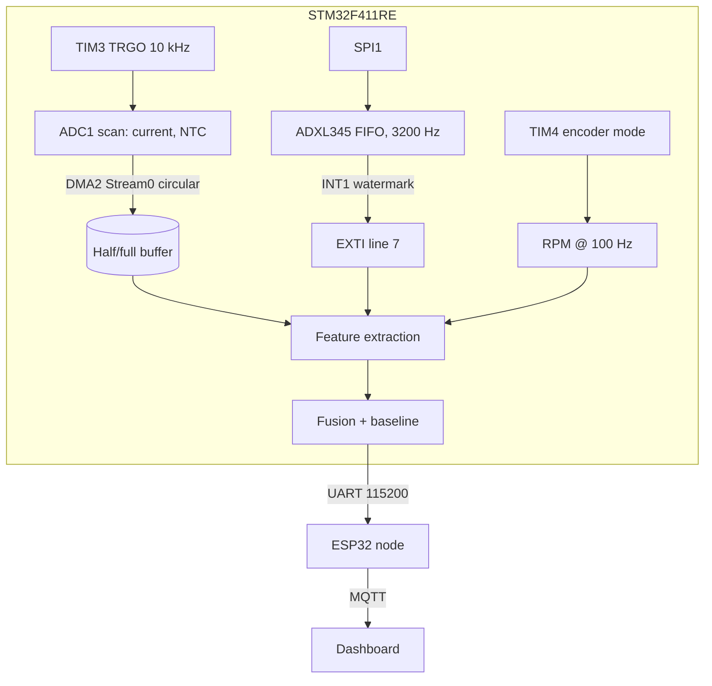

Imagine two motors that both trip a vibration alarm. One has a loose mounting bolt. The other is driving a jammed load and is about to burn out. A vibration sensor alone cannot tell you which is which, and the correct response is completely different: tighten a bolt in one case, cut the power immediately in the other. The jammed motor would probably show a *drop* in speed and a *rise* in current. The loose bolt would show neither.

That is the whole argument for sensor fusion, and it is the idea this build is organised around. In my [earlier ESP32 vibration article](/blog/vibration-based-failure-detection/) I used one accelerometer and a laptop FFT to detect that a machine had changed. Here the question is harder: not just *that* it changed, but what kind of change it looks like, using an STM32 that does the sampling and the maths itself.

:::note
**Status of this article:** this is a proposed design. I have not run this exact rig, so there are no measured results below. The code is written against the STM32 HAL and the ADXL345 datasheet and is meant to show the architecture, not to be copy-pasted as a finished product.
:::

## Why an STM32 and not another ESP32

An ESP32 can do all of this at a basic level. I chose an STM32 because the interesting part of this project is deterministic sampling, and the STM32's peripherals are built for it. A hardware timer can trigger an ADC conversion with no software involved, DMA can move the results into RAM with no CPU involvement, and the CPU only wakes when a half-buffer is ready. Sampling jitter is then a property of a crystal-driven timer, not of how busy the processor is.

I would use a **NUCLEO-F411RE**. It has a Cortex-M4F core running up to 100 MHz with a single-precision FPU and DSP instructions, 512 KB of flash and 128 KB of RAM. Do not assume your board matches this. STM32 families differ in clock speed, number of ADCs, DMA stream mapping, cache presence and available timers, and the pin numbers below come from the F411RE alternate-function table. Confirm every one of them in STM32CubeMX and in the Nucleo user manual for your own board before wiring.



## The hardware and what each part is for

| Signal | Part | STM32 resource | Pin (NUCLEO-F411RE) |
| --- | --- | --- | --- |
| Vibration | ADXL345 | SPI1, EXTI7 | PA5 SCK, PA6 MISO, PA7 MOSI, PB10 CS, PC7 INT1 |
| Motor current | Hall sensor, e.g. ACS712-05B | ADC1 IN0 | PA0 |
| Temperature | 10 kΩ NTC on motor case | ADC1 IN1 | PA1 |
| Shaft speed | Quadrature encoder | TIM4 encoder mode | PB6 CH1, PB7 CH2 |
| Motor drive | H-bridge input | TIM1 CH1 PWM | PA8 |
| Link to ESP32 | UART | USART1 | PA9 TX, PA10 RX |

Each sensor has a catch that matters for correctness, not just wiring.

The **ADXL345** is a 3.3 V device with both SPI and I²C. I chose SPI because the highest output data rate, 3200 Hz, needs a bus faster than fast-mode I²C can deliver; the datasheet lists the minimum bus speed for each output rate, and 3200 Hz needs roughly 2 MHz of SPI clock. The SPI mode is mode 3 (clock idles high, data captured on the second edge). Set that wrong and you read garbage with no error message.

The **ACS712** is usually powered from 5 V and its output centres at about 2.5 V, swinging up to roughly 4.5 V. The STM32's pins are 3.3 V logic and the ADC reference is 3.3 V, so the output goes through a resistor divider, for example 10 kΩ over 20 kΩ giving a 2/3 ratio, before it reaches PA0. Forgetting that divider does not just clip the reading. It over-drives the pin and can damage the chip. The divider also becomes the ADC's source impedance, so I would add a small capacitor at the pin and use a long enough ADC sampling time to let it settle.

The **NTC** thermistor goes in a divider with a fixed 10 kΩ resistor, converted with the beta equation. It will read the casing of the motor, not the winding, which is a limitation worth stating out loud.

The **encoder** is read by a timer in hardware encoder mode, which counts both edges of both channels without any CPU code at all. Counts per motor-shaft revolution depend on your encoder and on whether it sits before or after a gearbox, so measure it by turning the shaft one full turn by hand and reading the counter.

## ADC, timer trigger and DMA: the sampling backbone

The common beginner approach is `HAL_ADC_GetValue()` in a loop with a delay. It works until the loop does something else, and then your sample period changes silently. The robust design has three pieces.

TIM3 runs from a 100 MHz timer clock. On this part, timer clocks on both APB buses end up at 100 MHz when the system runs at full speed, because the APB1 prescaler of 2 doubles the timer clock back up. Setting PSC = 99 gives a 1 MHz tick, and ARR = 99 then gives a 10 kHz update event, which is routed out as TRGO. ADC1 is configured to start a conversion on that trigger, in scan mode over two channels, and DMA2 Stream 0 (channel 0 for ADC1) runs in circular mode into a buffer in SRAM.

```c
#define ADC_CH        2
#define ADC_FRAMES    512                      // frames per half buffer
static uint16_t adc_buf[2 * ADC_FRAMES * ADC_CH];
volatile uint8_t adc_half_ready = 0, adc_full_ready = 0;

void sampling_start(void) {
  HAL_ADC_Start_DMA(&hadc1, (uint32_t *)adc_buf, 2 * ADC_FRAMES * ADC_CH);
  HAL_TIM_Base_Start(&htim3);                  // TRGO now triggers each scan
}
void HAL_ADC_ConvHalfCpltCallback(ADC_HandleTypeDef *h) { adc_half_ready = 1; }
void HAL_ADC_ConvCpltCallback(ADC_HandleTypeDef *h)     { adc_full_ready = 1; }
```

In CubeMX the settings that make this actually work are: scan conversion mode enabled, continuous conversion **disabled** (the timer is the pacemaker), external trigger set to Timer 3 TRGO with rising edge, **DMA continuous requests enabled**, DMA mode circular, and data width half-word on both sides. The callbacks only raise flags. All the real work happens in the main loop, because a callback that runs 20 ms of maths inside an interrupt context starves everything else.

At a 25 MHz ADC clock (APB2 divided by 4) and a 56-cycle sample time, each conversion takes about 68 cycles, around 2.7 µs, so two channels fit comfortably inside the 100 µs trigger period. The slack is deliberate. It is what lets me raise the sample time for a high-impedance source without missing a trigger.

## Reading the ADXL345 over SPI

The accelerometer has its own 32-entry FIFO. I configure it in stream mode with a watermark of 16, and route the watermark interrupt to INT1. The STM32 does not poll; it waits for the interrupt, then drains the FIFO.

```c
static inline void cs(int on) {
  HAL_GPIO_WritePin(ADXL_CS_GPIO_Port, ADXL_CS_Pin, on ? GPIO_PIN_RESET : GPIO_PIN_SET);
}
static void adxl_write(uint8_t reg, uint8_t val) {
  uint8_t tx[2] = { reg & 0x3F, val };
  cs(1); HAL_SPI_Transmit(&hspi1, tx, 2, 10); cs(0);
}
static void adxl_read_sample(int16_t *xyz) {
  uint8_t cmd = 0x80 | 0x40 | 0x32, raw[6];       // read + multi-byte, start at DATAX0
  cs(1); HAL_SPI_Transmit(&hspi1, &cmd, 1, 10);
  HAL_SPI_Receive(&hspi1, raw, 6, 10); cs(0);
  for (int i = 0; i < 3; i++) xyz[i] = (int16_t)(raw[2*i+1] << 8 | raw[2*i]);
}
void adxl_init(void) {
  adxl_write(0x2C, 0x0F);   // BW_RATE: 3200 Hz output data rate
  adxl_write(0x31, 0x0B);   // DATA_FORMAT: full resolution, +/-16 g
  adxl_write(0x38, 0x90);   // FIFO_CTL: stream mode, watermark = 16
  adxl_write(0x2E, 0x02);   // INT_ENABLE: watermark
  adxl_write(0x2D, 0x08);   // POWER_CTL: measure mode
}
```

I would read register 0x00 first and expect 0xE5, the device ID. It is the cheapest possible test that the wiring and SPI mode are right. In full-resolution mode the scale is about 3.9 mg per count regardless of range. The datasheet also asks for a short gap between successive FIFO entry reads, which the chip-select toggling between samples in the function above provides.

SPI1 hangs off the 100 MHz APB2 bus, so a divider of 32 gives roughly 3.1 MHz, under the ADXL345's 5 MHz limit. That is the thing I like about SPI here: at 3200 samples per second, 16 samples arrive every 5 ms, and draining them takes a small fraction of that window.

## From samples to features

For every one-second analysis window, the firmware computes a small set of features:

- **Vibration RMS** after subtracting the mean, because gravity is a DC offset that would otherwise dominate the number.
- **1X amplitude**, the spectral energy at the shaft rotation frequency.
- **Current RMS and ripple**, after converting counts back to amperes through the divider ratio and the sensor sensitivity.
- **Temperature and its slope** in °C per minute, which says far more than the absolute value.
- **Speed** from the encoder.

The encoder is not just a speed sensor. It tells the FFT code where to look. A motor at 1,800 rpm turns at 30 Hz, so the 1X peak is at 30 Hz. At 3200 samples per second and a 1024-point transform the bin spacing is 3.125 Hz, so 30 Hz lands between bins 9 and 10. A fixed frequency band would be wrong the moment the speed changes. Looking up the 1X bin from the measured speed makes the analysis follow the machine.

```c
#include "arm_math.h"
#define N 1024
static float32_t win[N], in[N], spec[N], mag[N/2];
static arm_rfft_fast_instance_f32 rfft;

void fft_init(void) {
  arm_rfft_fast_init_f32(&rfft, N);
  for (int i = 0; i < N; i++) win[i] = 0.5f - 0.5f * arm_cos_f32(2*PI*i/(N-1));  // Hann
}
float band_amp_g(const float32_t *x_g, float f_hz, float fs) {
  float mean = 0; for (int i = 0; i < N; i++) mean += x_g[i]; mean /= N;
  for (int i = 0; i < N; i++) in[i] = (x_g[i] - mean) * win[i];
  arm_rfft_fast_f32(&rfft, in, spec, 0);
  arm_cmplx_mag_f32(spec, mag, N/2);
  mag[0] = fabsf(spec[0]);                    // packed output: bin 0/Nyquist share slot 0/1
  int k = (int)(f_hz * N / fs + 0.5f);
  float peak = 0;
  for (int j = k-1; j <= k+1; j++) if (mag[j] > peak) peak = mag[j];
  return peak * 2.0f / (N * 0.5f);           // amplitude, corrected for Hann coherent gain
}
```

I would time this function with the DWT cycle counter on the real board instead of trusting a quoted figure. That is also how you prove, to yourself and to a judge, that the analysis finishes well inside the one-second window.

## Fusion, and why it earns its keep

During a baseline run, the machine operates at several speeds in a known healthy state and the firmware records the mean and standard deviation of each feature for each speed. Afterwards, every new window is turned into z-scores against the baseline at the matching speed. Comparing against the baseline at the same speed is crucial, because a motor running faster legitimately draws more current and vibrates more.

```c
typedef struct { float mean, sd; } stat_t;
static inline float zscore(float x, stat_t s) { return (x - s.mean) / fmaxf(s.sd, 1e-6f); }

const char *classify(float zV1x, float zI, float zT, float zSpeedLoss) {
  if (zI > 3 && zSpeedLoss > 2 && zV1x < 2)   return "LOAD/JAM: current up, speed down";
  if (zV1x > 3 && zI < 2)                      return "IMBALANCE or LOOSE MOUNT";
  if (zT > 3 && zI > 2)                        return "FRICTION/BEARING SUSPECT";
  if (zV1x > 3 || zI > 3 || zT > 3)            return "ANOMALY: unclassified";
  return "OK";
}
```

| Fault demonstrated | Vibration 1X | Current | Temperature | Speed |
| --- | --- | --- | --- | --- |
| Added mass on shaft (imbalance) | Rises strongly | Roughly unchanged | Unchanged | Unchanged |
| Brake or jam | Little change | Rises | Rises slowly | Falls |
| Dry or worn bearing | Rises, often broadband | Rises slightly | Rises over minutes | Slightly lower |
| Loose mounting | Rises, harmonics | Unchanged | Unchanged | Unchanged |

These rows are what I *expect* from the physics. They are the hypotheses the exhibition should test, not results I have collected. If the real data disagrees with a row, that disagreement is the interesting finding.

## The ESP32 communication node

The STM32 sends one compact line per second, with a checksum, over USART1 at 115200 baud. A small ESP32 turns it into MQTT. This split keeps the Wi-Fi stack away from the sampling code entirely, which matters because Wi-Fi activity is a classic source of timing disturbance on single-chip designs.

```cpp
// ESP32 Arduino core 3.x. UART1 remapped to GPIO18 (RX) and GPIO19 (TX).
#include <WiFi.h>
#include <PubSubClient.h>
WiFiClient net; PubSubClient mqtt(net);

void setup() {
  Serial1.begin(115200, SERIAL_8N1, 18, 19);
  WiFi.begin("SSID", "PASSWORD");
  while (WiFi.status() != WL_CONNECTED) delay(200);
  mqtt.setServer("raspberrypi.local", 1883);
}
void loop() {
  if (!mqtt.connected()) mqtt.connect("motor-node");
  mqtt.loop();
  if (Serial1.available()) {
    String line = Serial1.readStringUntil('\n');   // e.g. "$V1X=0.12,I=0.84,T=41.2,RPM=1790*5A"
    if (validChecksum(line)) mqtt.publish("lab/motor1/status", line.c_str());
  }
}
```

Validate the checksum before publishing; otherwise a noisy UART turns a corrupted number into a fake alarm on the dashboard. The `validChecksum` helper is a few lines you write against your own line format. I have not compiled this sketch here, and the dependency set is small enough that it should sit well inside a standard 4 MB ESP32 flash layout, but check the size output of your own build.


## Troubleshooting

### DMA delivers one buffer and then stops

The symptom is a first half-buffer callback and then silence. The cause on the F4 family is the DMA continuous requests setting. With circular DMA but that option disabled, the ADC issues a single series of DMA requests and never asks again. The diagnostic is to read the DMA stream's `NDTR` register through the debugger and see that it never reloads. The fix is to enable continuous DMA requests in the ADC settings. On a Cortex-M7 part, such as an F7 or H7, a different bug appears: the CPU data cache can serve stale data that DMA has overwritten, so the buffer must sit in non-cacheable memory or be invalidated before reading. The F411 has no data cache, which is one more reason board differences matter.

### The current reading looks noisy and strangely periodic

The symptom is a current waveform with slow beating that changes when you change the motor duty cycle. The cause is aliasing. The motor PWM runs at, say, 20 kHz, and the ADC samples at 10 kHz, so the ripple folds down into low frequencies. A scope on the sensor output shows clean ripple, while the ADC shows nonsense. The correction is physical filtering: an RC low-pass with a corner well below half the sampling rate before the ADC pin. The alternative is to trigger the ADC from the PWM timer itself so every sample lands at the same point in the PWM cycle.

### The FFT peak is at the wrong frequency

The symptom is a 1X peak 5 or 10 percent away from the encoder's speed. The cause is usually that the real sample rate is not the one you assumed. The ADXL345 output data rate is derived from the chip's internal oscillator and is specified with a tolerance, whereas the timer-driven ADC is crystal-accurate. Diagnose it by running the motor at a speed the encoder reports precisely, then comparing the observed peak to the expected bin. If the ADXL345 runs a little off nominal, calibrate its effective rate against the encoder, or timestamp FIFO batches using the STM32 timer and compute the true rate from those.

### The accelerometer data has gaps or jumps

The symptom is occasional spikes and a spectrum with a raised noise floor. The cause is a FIFO overflow or a mis-timed read. Sixteen entries at 3200 Hz leave only 5 ms to drain the FIFO before the 32-entry buffer fills, and any long blocking call in the main loop, such as a UART print, can exceed that. Check the overflow bit in the interrupt source register and toggle a GPIO around the drain routine to measure its duration on a logic analyser. The fix is to keep the main loop non-blocking, move UART output to DMA or interrupt-driven transmission, and raise the watermark if you need more margin.

### False alarms when the speed changes

The symptom is an alarm every time someone adjusts the motor speed. The cause is comparing features against a single global baseline. The diagnostic is to log the z-scores and see them rise and fall with the PWM duty. The fix is the per-speed baseline described above, plus a short hold-off after any commanded speed change so the system waits for the motor to settle.

## Making it exhibition-ready

The problem this addresses is real: unplanned machine stoppages are expensive, and many small factories have no monitoring at all. What makes the project technically strong is the architecture. It uses hardware-timed sampling instead of software delays, DMA instead of polling, an encoder-guided FFT and a fusion step that reasons about more than one sensor.

The demonstration should be a controlled fault sequence on a small motor: baseline, then added mass on the shaft, then partial braking, then a loosened mount, with the dashboard showing which features moved and what the classifier said. Judges will probably ask why you need four sensors, how you know the thresholds are not just tuned to your demo, what your sampling rate is and why, and what happens at a speed you did not baseline. Keep the answers honest. Measurable results include detection rate and false-alarm rate across repeated fault injections, the confusion matrix of your classifier, FFT computation time measured on the board, and the CPU load.

Natural extensions include adding the second and third accelerometer axes, an I²C OLED for local status, comparing your rule-based fusion with a simple trained classifier, and measuring true energy per revolution using the techniques from the [IoT energy monitoring build](/blog/iot-energy-monitoring-system/). For a different kind of electrical measurement challenge on the same STM32 family, see the [smart microgrid monitoring article](/blog/smart-microgrid-monitoring/).